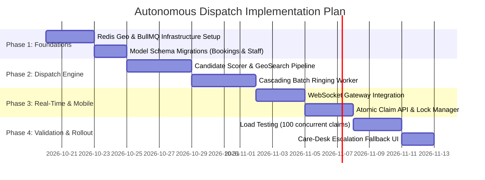

# Autonomous On-Demand Service Allocation Engine
## System Design & Architecture Specification (Rapido-Style Dispatch)

- **Target System**: Eldoria Care Platform (`/backend`)
- **Document Version**: 1.0.0
- **Audited Reference**: `https://github.com/morluto/rea.git`
- **Status**: Complete Architecture Specification

---

## 1. Executive Summary

This architecture specification details the end-to-end system design required to transition the **Eldoria Care** backend from its current **manual, admin-mediated booking assignment workflow** into an **autonomous, on-demand service allocation engine**, modeled after two-sided mobility platforms such as **Rapido, Uber, and Grab**.

### The Core Objective
Eliminate administrative bottlenecks by automating the entire lifecycle of a service request:
1. When a client requests a service, the system autonomously identifies the most qualified, nearby, on-duty staff.
2. The system broadcasts time-sensitive offers directly to staff devices (Batch Ringing).
3. The first eligible staff member to accept the offer claims the booking atomically.
4. Fallback escalations, dynamic radius expansion, and unassigned dead-letter handling occur automatically without manual dispatch desk intervention.

---

## 2. Audit of Reference Repository: `morluto/rea.git`

Before formulating this system design, a complete clone and inspection of `https://github.com/morluto/rea.git` was conducted.

```
morluto/rea
├── bridge/          # Native socket bridges (Hopper, Ghidra)
├── src/
│   ├── android/     # JADX / APKTool / ADB reverse engineering
│   ├── browser/     # CDP & Playwright network/DOM recording
│   ├── ghidra/      # Headless Ghidra decompiler integration
│   ├── hopper/      # Hopper disassembler bridge
│   ├── ida/         # IDA Pro headless database supervisor
│   ├── native/      # Pwntools, GDB, PE/ELF binary analysis
│   ├── wasm/ & evm/ # Bytecode analysis & EVMole disassembly
│   └── server/      # Model Context Protocol (MCP) tool adapter
```

### Key Technical Findings:
1. **Actual Scope**: `morluto/rea` stands for **"Reverse Engineer Anything"**. It is a reverse engineering toolkit and Model Context Protocol (MCP) server designed to inspect binaries, decompiled Android APKs, and browser runtimes.
2. **Dispatch / Ride-Sharing Code**: The repository **contains no ride-allocation algorithms, dispatch engines, geospatial indexes, or two-sided marketplace brokers**.
3. **Strategic Context**:
   - If the intent was to use `rea` to decompile production ride-sharing applications (e.g., Rapido, Uber) to reverse-engineer client API payloads and WebSocket messages, `rea`'s Android engine (`src/android/`) provides headless JADX decompilation.
   - However, for building a **native, production-grade automated dispatch system** in Eldoria, the core infrastructure (Redis Geospatial indexing, state machines, atomic lock management, and WebSocket gateways) must be implemented directly in the backend.

---

## 3. Current Eldoria Architecture vs. Rapido Dispatch Architecture

| Capability | Eldoria Current Architecture | Rapido-Style Target Architecture |
| :--- | :--- | :--- |
| **Trigger Mechanism** | Client submits booking $\to$ status is `'requested'` $\to$ sits idle in SQL database. | Event `BOOKING_CREATED` triggers an immediate background Dispatch Cycle. |
| **Staff Selection** | Admin opens care-desk UI $\to$ calls `/booking/:id/available-staff`. | Redis Geo / H3 spatial index identifies online, nearby staff in $< 5\text{ ms}$. |
| **Allocation Action** | Admin manually clicks "Assign" $\to$ calls `/booking/:id/assign`. | Automated time-bounded offer sent to staff mobile apps via WebSocket / Push. |
| **Concurrency & Claims** | Single admin action (no race condition protection). | Distributed atomic locking (`SETNX` / Lua + DB Row Lock) prevents double claims. |
| **Radius Expansion** | Query param `increaseArea=true` manually clicked by care-desk. | Step-ladder expansion ($3\text{km} \to 6\text{km} \to 10\text{km}$) every 20 seconds. |
| **Location Source** | Static string matching via `AREA_COORDINATES` lookup table. | Dynamic high-frequency GPS heartbeats from active staff devices. |
| **Failure Handling** | Unassigned bookings sit indefinitely until an admin notices. | Automated timeout, surge incentive injection, and escalation alerting. |

---

## 4. End-to-End System Architecture

```mermaid
graph TD
    subgraph "Client Tier"
        ClientApp["Client Mobile App / Web"]
    end

    subgraph "Staff Tier"
        StaffApp["Staff Mobile App (On-Duty)"]
    end

    subgraph "API & Gateway Layer"
        APIGateway["Express.js API Gateway"]
        WSGateway["WebSocket / Socket.io Gateway"]
    end

    subgraph "Event & Dispatch Core"
        Queue["BullMQ / Redis Streams (Dispatch Queue)"]
        DispatchWorker["Autonomous Dispatch Worker"]
        LockManager["Redis Distributed Lock Manager (Redlock / SETNX)"]
    end

    subgraph "Data & Cache Layer"
        RedisGeo["Redis In-Memory Spatial Index (GEO / H3)"]
        MySQL["MySQL Database (Sequelize ORM)"]
    end

    ClientApp -->|1. POST /client/bookings| APIGateway
    APIGateway -->|2. Insert Booking ('searching')| MySQL
    APIGateway -->|3. Enqueue Dispatch Job| Queue
    
    StaffApp -->|Location Heartbeat (every 15s)| WSGateway
    WSGateway -->|Update Lat/Lng & Status| RedisGeo

    Queue -->|4. Consume Job| DispatchWorker
    DispatchWorker -->|5. Query Nearby Staff| RedisGeo
    DispatchWorker -->|6. Score & Rank Candidates| DispatchWorker
    DispatchWorker -->|7. Push Offer (Batch Ringing)| WSGateway
    WSGateway -->|8. Ring Staff Devices (15s Timer)| StaffApp

    StaffApp -->|9. Tap 'Accept'| APIGateway
    APIGateway -->|10. Acquire Atomic Claim| LockManager
    LockManager -->|11. Lock Granted| APIGateway
    APIGateway -->|12. Commit 'assigned' Status| MySQL
    APIGateway -->|13. Cancel Active Rings| WSGateway
    WSGateway -->|14. Dismiss Ring Modal| StaffApp
```

---

## 5. Core Architectural Components

### 5.1 Real-Time Geospatial Indexing (Dynamic Location Layer)
Instead of static area string dictionaries, staff coordinates are indexed in **Redis Geospatial Data Structures**:

1. **Staff Location Heartbeat**:
   When staff toggles `onDuty: true`, the mobile app emits a heartbeat every 15–30 seconds:
   ```
   GEOADD staff:geo:<city> <longitude> <latitude> <staffId>
   HSET staff:state:<staffId> onDuty 1 isBusy 0 lastPing <timestamp>
   EXPIRE staff:geo:<city> 60
   ```
2. **Sub-millisecond Candidate Search**:
   ```javascript
   // Query all staff within radius R of patient's coordinates
   const candidateStaffIds = await redis.geosearch(
     `staff:geo:${booking.city}`,
     'FROMLONLAT', patientLng, patientLat,
     'BYRADIUS', searchRadiusKm, 'km',
     'WITHDIST',
     'ASC'
   );
   ```

---

### 5.2 Pre-Qualification & Candidate Scoring Pipeline
Retaining and elevating Eldoria's domain rules from [`staffMatching.helper.js`](file:///c:/DDPL/Work/Eldoria/backend/src/helpers/staffMatching.helper.js):

$$\text{Total Score} = (S_{\text{proximity}} \times 0.35) + (S_{\text{skills}} \times 0.40) + (S_{\text{fairness}} \times 0.15) + (S_{\text{rating}} \times 0.10)$$

1. **Hard Constraints (Must Pass)**:
   - `approval === 'approved'`
   - `onDuty === true`
   - `isBusy === false` (not currently checked-in at another booking)
   - `evaluateServiceSkillMatch(booking, staff) === true` (mandatory medical qualification matching, e.g., GNM/ANM nurse for clinical procedures, BPT for physiotherapy).
2. **Soft Scoring Factors**:
   - **Proximity**: Linear decay based on actual road distance/ETA.
   - **Fairness (Anti-Starvation)**: Staff with longer idle times since their last completed visit receive a priority boost.
   - **Acceptance History**: Staff with high acceptance rates are prioritized over chronic rejectors.

---

### 5.3 Dispatch Strategies: Cascading Batch Ringing

Rapido employs **Cascading Batch Ringing** to maximize fulfillment speed while preventing network congestion:

```mermaid
stateDiagram-v2
    [*] --> Ring1: Booking Created (Status: searching)
    
    Ring1: Ring 1 (0 to 3 km)
    note right of Ring1: Broadcast to Top 3 Candidates\nTimer: 15 Seconds
    
    Ring1 --> Assigned: Any Staff Accepts
    Ring1 --> Ring2: 15s Timeout / All Reject
    
    Ring2: Ring 2 (3 to 7 km)
    note right of Ring2: Broadcast to Next 5 Candidates\nTimer: 20 Seconds
    
    Ring2 --> Assigned: Any Staff Accepts
    Ring2 --> Ring3: 20s Timeout / All Reject
    
    Ring3: Ring 3 (7 to 12 km)
    note right of Ring3: City-Wide Broadcast\nTimer: 25 Seconds
    
    Ring3 --> Assigned: Any Staff Accepts
    Ring3 --> Escalated: No Staff Accepted
    
    Escalated: Unassigned Escalation
    note right of Escalated: Status: unassigned_escalated\nCare Desk High-Priority Alert\nSurge Incentive Triggered
```

---

### 5.4 Concurrency Control & Atomic Claim Engine

In an autonomous system, multiple staff members may attempt to accept the same booking offer simultaneously. A two-phase atomic locking strategy ensures zero double-allocations:

#### Phase 1: Distributed Mutex via Redis `SETNX`
```javascript
const claimLockKey = `lock:booking:claim:${bookingId}`;
// Acquire 5-second exclusive lock
const acquired = await redis.set(claimLockKey, staffId, 'NX', 'EX', 5);
if (!acquired) {
  return { success: false, code: "ALREADY_CLAIMED", message: "Visit accepted by another caregiver." };
}
```

#### Phase 2: Relational Row-Level Lock with Optimistic Versioning
```javascript
const transaction = await sequelize.transaction();
try {
  const booking = await Booking.findOne({
    where: {
      id: bookingId,
      status: 'searching' // Atomic gate: must still be in 'searching' state
    },
    lock: transaction.LOCK.UPDATE,
    transaction
  });

  if (!booking) {
    await transaction.rollback();
    return { success: false, code: "INVALID_STATE", message: "Booking is no longer available." };
  }

  // Commit assignment
  await booking.update({
    staffId: staff.staffId,
    status: 'assigned',
    assignedAt: new Date(),
    assignedBy: 'system:autonomous_dispatch'
  }, { transaction });

  await transaction.commit();

  // Broadcast cancelation to dismiss ringing modal on competing staff devices
  await redis.publish('dispatch:broadcast', JSON.stringify({
    event: 'DISPATCH_OFFER_CANCELLED',
    bookingId: booking.id,
    claimedBy: staff.staffId
  }));

  return { success: true, booking };
} catch (error) {
  await transaction.rollback();
  throw error;
} finally {
  await redis.del(claimLockKey);
}
```

---

## 6. Database Schema Enhancements

To support the autonomous dispatch lifecycle, update the existing models in [`database/models/`](file:///c:/DDPL/Work/Eldoria/backend/src/database/models/):

### 6.1 `bookings` Table Alterations
```diff
--- a/backend/src/database/models/booking.model.js
+++ b/backend/src/database/models/booking.model.js
@@ -95,6 +95,8 @@ module.exports = (sequelize) => {
     status: {
       type: DataTypes.ENUM(
         'requested',
+        'searching',
+        'unassigned_escalated',
         'confirmed',
         'assigned',
         'on_the_way',
@@ -103,7 +105,7 @@ module.exports = (sequelize) => {
         'cancelled'
       ),
-      defaultValue: 'requested',
+      defaultValue: 'searching',
       allowNull: false
     },
+    pickupLat: {
+      type: DataTypes.DECIMAL(10, 7),
+      allowNull: true
+    },
+    pickupLng: {
+      type: DataTypes.DECIMAL(10, 7),
+      allowNull: true
+    },
+    dispatchRing: {
+      type: DataTypes.INTEGER,
+      defaultValue: 0
+    },
```

### 6.2 `staffs` Table Alterations
```diff
--- a/backend/src/database/models/staff.model.js
+++ b/backend/src/database/models/staff.model.js
@@ -136,6 +136,18 @@ module.exports = (sequelize) => {
       onDuty: {
         type: DataTypes.BOOLEAN,
         defaultValue: false,
         allowNull: false,
       },
+      isBusy: {
+        type: DataTypes.BOOLEAN,
+        defaultValue: false,
+        allowNull: false
+      },
+      currentLat: {
+        type: DataTypes.DECIMAL(10, 7),
+        allowNull: true
+      },
+      currentLng: {
+        type: DataTypes.DECIMAL(10, 7),
+        allowNull: true
+      },
+      lastLocationAt: {
+        type: DataTypes.DATE,
+        allowNull: true
+      },
```

---

## 7. Real-Time Communication & API Contracts

### 7.1 Staff Location Ping Endpoint
- **Method & Route**: `POST /api/v1/staff/location/heartbeat`
- **Headers**: `Authorization: Bearer <staff_jwt>`
- **Payload**:
  ```json
  {
    "latitude": 19.1136,
    "longitude": 72.8697,
    "onDuty": true,
    "batteryLevel": 85
  }
  ```
- **Response** (`200 OK`):
  ```json
  {
    "success": true,
    "activeOffersCount": 0,
    "status": "online_available"
  }
  ```

---

### 7.2 WebSocket Offer Event (`DISPATCH_OFFER_RING`)
Emitted over WebSocket directly to candidate staff client sockets:
```json
{
  "event": "DISPATCH_OFFER_RING",
  "data": {
    "bookingId": 402,
    "bookingCode": "BK-261019-9481",
    "serviceName": "Physiotherapy - Stroke Rehabilitation",
    "patientArea": "Andheri West, Mumbai",
    "distanceKm": 2.4,
    "estimatedTravelTimeMin": 8,
    "payout": 650.00,
    "timeoutSeconds": 15,
    "expiresAt": "2026-10-19T10:35:15.000Z"
  }
}
```

---

### 7.3 Staff Claim / Acceptance Endpoint
- **Method & Route**: `POST /api/v1/staff/bookings/:id/accept`
- **Headers**: `Authorization: Bearer <staff_jwt>`
- **Response Success** (`200 OK`):
  ```json
  {
    "success": true,
    "message": "Visit successfully assigned to you.",
    "booking": {
      "id": 402,
      "code": "BK-261019-9481",
      "status": "assigned",
      "patientName": "Sunita Sharma",
      "patientAge": "68",
      "address": "Flat 402, Sea Green Heights, Versova, Andheri West",
      "clientPhone": "9820123456"
    }
  }
  ```
- **Response Conflict** (`409 Conflict`):
  ```json
  {
    "success": false,
    "code": "ALREADY_CLAIMED",
    "message": "Another caregiver accepted this visit first."
  }
  ```

---

## 8. Failure Modes & Fault Tolerance

| Failure Scenario | Impact | Mitigation Strategy |
| :--- | :--- | :--- |
| **Simultaneous Acceptances** | Two staff members accept at the exact same millisecond. | Redis `SETNX` distributed lock acts as a single-entry gate. Only the winner updates MySQL; the loser receives an immediate `409 Conflict` with audible feedback. |
| **Ghost / Offline Staff** | Staff turns off mobile data without toggling `onDuty: false`. | Redis Geo records expire via 60-second TTL. Background sweeper marks staff `onDuty: false` if no heartbeat is received within 90 seconds. |
| **No Staff Accept (Zero Acceptance)** | Booking stays open after Ring 3 (12 km). | Status transitions to `unassigned_escalated`. BullMQ pushes a high-priority alert to the Care Desk dashboard with audio chimes and SMS/WhatsApp escalation. |
| **Staff No-Show / Late Cancelation** | Staff accepts but cancels 10 minutes later. | Booking is instantly re-injected into the Dispatch Engine at Ring 2 (expanded) with a penalty recorded against the canceling staff's completion rate. |
| **Redis Node Outage** | Cache fails. | Seamless fallback to SQL query on `staffs` using Haversine formula directly (using existing logic in `staffMatching.helper.js`). |

---

## 9. Phased Implementation Roadmap



### Actionable Next Steps:
1. Run database migration to add `searching` and `unassigned_escalated` statuses to `bookings`.
2. Install `ioredis` and `bullmq` in `backend/package.json`.
3. Create `backend/src/services/dispatch.service.js` implementing the Redis Geo search and atomic claim routines outlined in Section 5.
