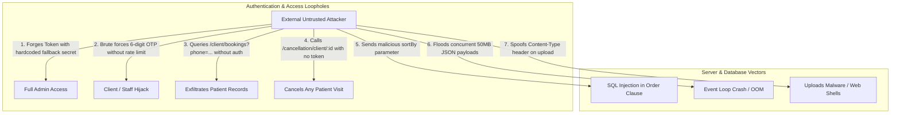

# Eldoria Care Backend Security Audit & Vulnerability Assessment Report

**Date of Audit**: October 17, 2026  
**Audited Target**: Eldoria Care Backend Service (`/backend`)  
**Runtime & Framework**: Node.js v20+ / Express 5.2.1 / Sequelize ORM 6.37.8 / MySQL  
**Scope**: Database, Server Infrastructure, Authentication, Access Controls, API Endpoints, File Upload Pipelines, and Secrets Management.

---

## 1. Executive Summary

This comprehensive security audit evaluated the Eldoria Care backend codebase across all active routes, controllers, middleware, and database models. The audit revealed **critical architectural and implementation loopholes** that expose the platform to:
- **Authentication Bypasses & Account Takeovers**: Hardcoded fallback JWT secrets and predictable OTP generation without lockout.
- **Data Breaches & Privacy Violations (BOLA / IDOR)**: Unauthenticated access to private patient booking histories, medical conditions, and uploaded staff IDs.
- **SQL Injection (SQLi)**: Unsanitized dynamic `ORDER BY` clauses in administrative and enquiry listing endpoints.
- **Denial of Service (DoS / DDoS)**: Permissive 50MB payload limits and a complete absence of rate-limiting middleware.
- **Malware Upload & Storage**: Insecure file validation logic that accepts executables if request headers are spoofed.

### Threat Matrix & Vulnerability Summary

| Ref ID | Vulnerability Title | Severity | Impact Area | CWE / CVE | Status |
| :--- | :--- | :--- | :--- | :--- | :--- |
| **SEC-01** | SQL Injection via Dynamic `ORDER BY` Clauses | **HIGH** | Database | CWE-89 (CVE-2019-10748) | Open |
| **SEC-02** | Hardcoded Fallback JWT Secret Key | **CRITICAL** | Authentication | CWE-798 / CWE-321 | Open |
| **SEC-03** | Broken Object-Level Authorization (BOLA/IDOR) on Bookings & Enquiries | **CRITICAL** | Data Privacy | CWE-639 / CWE-284 | Open |
| **SEC-04** | Unauthenticated Booking Cancellation Bypass | **HIGH** | Business Logic | CWE-284 / CWE-862 | Open |
| **SEC-05** | Cryptographically Weak PRNG for OTPs (`Math.random()`) | **HIGH** | Authentication | CWE-330 / CWE-338 | Open |
| **SEC-06** | OTP Brute-Force Exposure (Missing Lockout Counter) | **HIGH** | Authentication | CWE-307 / CWE-799 | Open |
| **SEC-07** | Denial of Service (DoS) via 50MB Payload Flooding | **HIGH** | Server Health | CWE-400 / CWE-770 | Open |
| **SEC-08** | Complete Absence of Rate Limiting (Toll Fraud & Flooding) | **HIGH** | Server / Billing | CWE-799 | Open |
| **SEC-09** | Malware & Executable File Upload Bypass (`OR` Logic) | **HIGH** | File Storage | CWE-434 | Open |
| **SEC-10** | Unauthenticated Staff Document & PII Streaming | **HIGH** | Data Privacy | CWE-200 / CWE-639 | Open |
| **SEC-11** | Plaintext OTP Leakage in HTTP Responses & Terminal Logs | **MEDIUM** | Credentials | CWE-532 / CWE-200 | Open |
| **SEC-12** | Missing HTTP Security Headers (`helmet`) & Unsafe CORS | **MEDIUM** | Network / Client | CWE-16 / CWE-942 | Open |
| **SEC-13** | Plaintext Password Fallback in Admin Authentication | **MEDIUM** | Authentication | CWE-256 | Open |
| **SEC-14** | Silent Fallback to Unencrypted Database Connections | **MEDIUM** | Database | CWE-319 | Open |

---

## 2. In-Depth Vulnerability Analysis



---

### SEC-01: SQL Injection via Dynamic `ORDER BY` Clause
* **Severity**: **HIGH** (CVSS: 7.5)
* **Locations**:
  * [`src/controllers/admin.controller.js`](backend/src/controllers/admin.controller.js#L105) (Lines 105, 1196, 1354)
  * [`src/controllers/enquiry.controller.js`](backend/src/controllers/enquiry.controller.js#L316) (Line 316)
* **Flaw**:
  ```javascript
  const { sortBy = "createdAt", sortOrder = "DESC" } = req.query;
  // ...
  order: [[sortBy, sortOrder.toUpperCase() === "ASC" ? "ASC" : "DESC"]],
  ```
* **Impact**:
  Sequelize parameterizes `where` query values, but does **not** escape or bind column names in the `order` array. An attacker can inject arbitrary SQL statements (such as conditional boolean subqueries or sleep statements) through the `sortBy` query parameter.
* **Remediation**:
  Enforce a strict column whitelist:
  ```javascript
  const ALLOWED_SORT_COLUMNS = ['id', 'createdAt', 'updatedAt', 'name', 'status', 'date', 'code'];
  const safeSortBy = ALLOWED_SORT_COLUMNS.includes(sortBy) ? sortBy : 'createdAt';
  const safeOrder = sortOrder.toUpperCase() === 'ASC' ? 'ASC' : 'DESC';

  order: [[safeSortBy, safeOrder]],
  ```

---

### SEC-02: Hardcoded Fallback JWT Secret Key
* **Severity**: **CRITICAL** (CVSS: 9.8)
* **Locations**:
  * [`src/middlewares/auth.middleware.js`](backend/src/middlewares/auth.middleware.js#L14) (Lines 14, 27)
  * [`src/controllers/admin.auth.controller.js`](backend/src/controllers/admin.auth.controller.js#L71) (Line 71)
* **Flaw**:
  ```javascript
  const decoded = jwt.verify(token, process.env.JWT_SECRET || 'eldoria_super_secret_jwt_key_2026');
  ```
* **Impact**:
  If the `JWT_SECRET` environment variable is ever unset, empty, or misnamed in any deployment or container, the server silently falls back to `'eldoria_super_secret_jwt_key_2026'`. Anyone with read access to the repo or knowledge of this key can mint a valid JWT with `role: "admin"` and bypass all authentication.
* **Remediation**:
  Ensure the server terminates during startup if `JWT_SECRET` is missing:
  ```javascript
  if (!process.env.JWT_SECRET || process.env.JWT_SECRET.length < 32) {
    throw new Error('FATAL SECURITY ERROR: JWT_SECRET must be set and contain at least 32 characters.');
  }
  ```

---

### SEC-03: Broken Object-Level Authorization (BOLA / IDOR) on Bookings & Enquiries
* **Severity**: **CRITICAL** (CVSS: 9.1)
* **Locations**:
  * [`src/routes/client.routes.js`](backend/src/routes/client.routes.js#L61) (Lines 61, 74, 80, 81)
  * [`src/controllers/booking.controller.js`](backend/src/controllers/booking.controller.js#L247-L248) (Lines 247–248, 405–441)
  * [`src/controllers/enquiry.controller.js`](backend/src/controllers/enquiry.controller.js#L184-L185) (Lines 184–185, 221–240)
* **Flaw**:
  In `client.routes.js`, endpoints are protected only with `optionalToken`:
  ```javascript
  router.get("/bookings", optionalToken, getClientBookings);
  router.get("/booking/:id", optionalToken, getClientBookingById);
  router.get("/enquiries", optionalToken, getClientEnquiries);
  router.get("/enquiry/:id", optionalToken, getClientEnquiryById);
  ```
  In `booking.controller.js`:
  ```javascript
  const clientPhone = req.user?.phone || req.query.phone || "";
  const clientId = req.user?.id || req.query.clientId || null;
  ```
  And in `getClientBookingById`:
  ```javascript
  const booking = await Booking.findOne({ where: bookingLookup });
  // Ownership is checked for a boolean flag, but access is never denied!
  return successResponse(res, { booking, ... });
  ```
* **Impact**:
  Any unauthenticated user on the internet can:
  1. Send `GET /api/v1/client/bookings?phone=9876543210` to retrieve an entire history of patient visits, addresses, care needs, and staff assignments.
  2. Send `GET /api/v1/client/booking/1` or `GET /api/v1/client/enquiry/1` to view patient names, medical descriptions, and uploaded prescriptions without any login credentials.
* **Remediation**:
  Change `optionalToken` to `verifyToken, requireClient`. Force filters to use `req.user.phone` and `req.user.id`, ignoring unverified query parameters.

---

### SEC-04: Unauthenticated Booking Cancellation Bypass
* **Severity**: **HIGH** (CVSS: 8.2)
* **Locations**:
  * [`src/routes/cancellation.routes.js`](backend/src/routes/cancellation.routes.js#L14) (Line 14)
  * [`src/controllers/cancellation.controller.js`](backend/src/controllers/cancellation.controller.js#L118-L134) (Lines 118–134)
* **Flaw**:
  ```javascript
  router.patch("/client/:id", optionalToken, cancelClientBooking);
  ```
  Inside `cancelClientBooking`:
  ```javascript
  if (
    req.user &&
    req.user.phone &&
    req.user.role !== "admin" &&
    booking.clientPhone
  ) {
    // Verifies phone match...
  }
  ```
  If an unauthenticated caller sends **no token**, `req.user` is undefined, skipping the ownership check entirely and executing the cancellation transaction.
* **Impact**:
  Attackers can cancel any scheduled patient visit by cycling through booking IDs (`/api/v1/cancellation/client/101`, `/102`, etc.).
* **Remediation**:
  Enforce authentication (`verifyToken, requireClient`) on `cancellation.routes.js`.

---

### SEC-05: Insecure Pseudo-Random Number Generator for OTPs
* **Severity**: **HIGH** (CVSS: 7.5)
* **Locations**:
  * [`src/controllers/auth.controller.js`](backend/src/controllers/auth.controller.js#L87) (Line 87)
  * [`src/controllers/client.controller.js`](backend/src/controllers/client.controller.js#L59) (Line 59)
* **Flaw**:
  ```javascript
  const otpCode = Math.floor(100000 + Math.random() * 900000).toString();
  ```
* **Impact**:
  `Math.random()` relies on the non-cryptographic XorShift128+ algorithm. An attacker observing consecutive OTP values generated by the Node.js process can determine the internal PRNG state and predict future OTPs.
* **Remediation**:
  Use `crypto.randomInt`:
  ```javascript
  const crypto = require('crypto');
  const otpCode = crypto.randomInt(100000, 1000000).toString();
  ```

---

### SEC-06: OTP Brute-Force Exposure (Missing Lockout Counter)
* **Severity**: **HIGH** (CVSS: 8.1)
* **Locations**:
  * [`src/controllers/auth.controller.js`](backend/src/controllers/auth.controller.js#L164-L183) (Lines 164–183)
  * [`src/controllers/client.controller.js`](backend/src/controllers/client.controller.js#L125-L150)
* **Flaw**:
  When an incorrect OTP is provided, the API returns a `400 Invalid OTP` error, but:
  1. The failed attempt count is never tracked or persisted.
  2. The OTP remains valid for the full 10-minute window regardless of failures.
  3. No IP or phone lockout occurs.
* **Impact**:
  A 6-digit OTP has only $10^6$ combinations. Without rate limiting or attempt thresholds, an automated script sending 500 requests/second can reliably brute-force any active OTP within 5–10 minutes.
* **Remediation**:
  Add an `attempts` column to `otps`. Increment `attempts` on every failed check; if `attempts >= 5`, immediately mark `isVerified: true` (burn the OTP) and reject further requests.

---

### SEC-07: Denial of Service (DoS) via 50MB Payload Flooding
* **Severity**: **HIGH** (CVSS: 7.5)
* **Location**:
  * [`src/app.js`](backend/src/app.js#L15-L16) (Lines 15–16)
* **Flaw**:
  ```javascript
  app.use(express.json({ limit: '50mb' }));
  app.use(express.urlencoded({ extended: true, limit: '50mb' }));
  ```
* **Impact**:
  Setting a global 50MB limit on JSON and URL-encoded bodies allows attackers to transmit massive JSON strings to lightweight endpoints. Parsing high-volume JSON payloads on Node's single-threaded event loop saturates CPU and exhausts server RAM, causing Out-of-Memory (OOM) crashes.
* **Remediation**:
  Restrict global JSON parser limits to `1mb`. Handle file uploads exclusively via `multer`.

---

### SEC-08: Complete Absence of Rate Limiting
* **Severity**: **HIGH** (CVSS: 7.5)
* **Locations**:
  * [`src/app.js`](backend/src/app.js)
  * [`package.json`](backend/package.json)
* **Impact**:
  1. **SMS Toll Fraud**: Automated bots can trigger thousands of OTP SMS dispatches to premium or international numbers, exhausting SMS balances.
  2. **Credential Stuffing**: Unlimited login attempts against `/api/v1/admin/login` and `/api/v1/auth/verify-otp`.
* **Remediation**:
  Install `express-rate-limit` and attach dedicated limiters to authentication and OTP routes:
  - Global API limiter: 300 requests per 15 minutes per IP.
  - Auth / OTP endpoints: 5–10 requests per 15 minutes per IP/Phone.

---

### SEC-09: Malware & Executable File Upload Bypass
* **Severity**: **HIGH** (CVSS: 8.6)
* **Locations**:
  * [`src/services/cloudinary.service.js`](backend/src/services/cloudinary.service.js#L21-L32) (Lines 21–32)
  * [`src/middlewares/upload.middleware.js`](backend/src/middlewares/upload.middleware.js#L9-L17) (Lines 9–17)
* **Flaw**:
  ```javascript
  const isValidDocumentType = (mimetype = '', originalname = '') => {
    if (mimetype && ALLOWED_MIME_TYPES.includes(mimetype.toLowerCase())) {
      return true;
    }
    if (originalname) {
      const ext = path.extname(originalname).toLowerCase();
      if (ALLOWED_EXTENSIONS.includes(ext)) {
        return true;
      }
    }
    return false;
  };
  ```
* **Impact**:
  The validation uses **`OR`** logic:
  - An attacker uploading `exploit.exe` or `shell.php` with a spoofed header `Content-Type: image/jpeg` is accepted because `ALLOWED_MIME_TYPES.includes(mimetype)` evaluates to true.
  - Furthermore, magic numbers / byte headers are not inspected, enabling polyglot file uploads (e.g. PHP scripts embedded inside JPEG headers).
* **Remediation**:
  Use strict **`AND`** validation combined with magic byte detection via `file-type`:
  ```javascript
  const isValidDocumentType = (mimetype = '', originalname = '') => {
    if (!mimetype || !originalname) return false;
    const ext = path.extname(originalname).toLowerCase();
    return ALLOWED_MIME_TYPES.includes(mimetype.toLowerCase()) && ALLOWED_EXTENSIONS.includes(ext);
  };
  ```

---

### SEC-10: Unauthenticated Staff Document & PII Streaming
* **Severity**: **HIGH** (CVSS: 7.5)
* **Locations**:
  * [`src/routes/staff.routes.js`](backend/src/routes/staff.routes.js#L24) (Lines 24, 37, 39)
  * [`src/controllers/staff.controller.js`](backend/src/controllers/staff.controller.js#L744-L820)
* **Flaw**:
  - `GET /api/v1/staff/document/view`: Has **no authentication middleware** and streams documents from Cloudinary by signed URL based on query parameters.
  - `GET /api/v1/staff/application/:staffId/status`: Allows any caller to inspect the registration and background check status of any caregiver.
  - `PATCH /api/v1/staff/application/:staffId/update`: Unauthenticated route allowing arbitrary callers to overwrite an applicant's uploaded documents.
* **Impact**:
  Direct leakage of government IDs, criminal background checks, certificates, and personal caregiver records.
* **Remediation**:
  Add `verifyToken` and ensure the caller is either the owner (`req.user.id === staff.userId`) or an administrator.

---

### SEC-11: Plaintext OTP Leakage in HTTP Responses & Terminal Logs
* **Severity**: **MEDIUM** (CVSS: 6.5)
* **Locations**:
  * [`src/controllers/auth.controller.js`](backend/src/controllers/auth.controller.js#L131) (Line 131)
  * [`src/controllers/client.controller.js`](backend/src/controllers/client.controller.js#L100) (Line 100)
  * [`src/helpers/otpLogger.js`](backend/src/helpers/otpLogger.js#L34) (Line 34)
* **Flaw**:
  ```javascript
  otp: process.env.NODE_ENV === "production" ? undefined : otpCode
  ```
  If `NODE_ENV` is omitted or set to anything other than the exact lowercase string `"production"` (e.g. `staging`, `prod`, `test`), the plaintext OTP is returned in the API JSON body. In addition, `otpLogger.js` logs all OTPs to stdout.
* **Remediation**:
  Completely eliminate `otp` from API responses. Gate terminal logging strictly to local development (`process.env.NODE_ENV === 'development'`).

---

### SEC-12: Missing Security Headers & Misconfigured CORS
* **Severity**: **MEDIUM** (CVSS: 5.3)
* **Location**:
  * [`src/app.js`](backend/src/app.js#L10-L13) (Lines 10–13)
* **Flaw**:
  1. `helmet` is not used; `X-Powered-By: Express` is exposed.
  2. `origin: process.env.CORS_ORIGIN || '*'` combined with `credentials: true` is non-compliant with standard browser security models.
* **Remediation**:
  Install `helmet` and use an explicit CORS whitelist.

---

### SEC-13: Plaintext Password Fallback in Admin Authentication
* **Severity**: **MEDIUM** (CVSS: 6.8)
* **Location**:
  * [`src/controllers/admin.auth.controller.js`](backend/src/controllers/admin.auth.controller.js#L55-L58) (Lines 55–58)
* **Flaw**:
  ```javascript
  const isPasswordValid = adminUser.password.startsWith("$2")
    ? await bcrypt.compare(password, adminUser.password)
    : adminUser.password === password;
  ```
* **Impact**:
  Permits database storage and verification of unhashed admin passwords.
* **Remediation**:
  Require all passwords to be hashed with `bcrypt` (work factor $\ge 12$).

---

### SEC-14: Silent Fallback to Unencrypted Database Connections
* **Severity**: **MEDIUM** (CVSS: 5.9)
* **Location**:
  * [`src/configs/db.config.js`](backend/src/configs/db.config.js#L25-L28) (Lines 25–28)
* **Flaw**:
  If `aiven-ca.pem` is absent or unreadable, the application logs a warning and returns `{}`, establishing an unencrypted plaintext MySQL connection over the public internet.
* **Remediation**:
  Halt startup if the database mode is `server`/`aiven` and the SSL certificate is missing or invalid.

---

## 3. Step-by-Step Remediation Plan

### Phase 1: Immediate Critical Fixes (Within 24 Hours)

1. **Remove Hardcoded JWT Fallback**:
   Update [`src/middlewares/auth.middleware.js`](backend/src/middlewares/auth.middleware.js) and [`src/controllers/admin.auth.controller.js`](backend/src/controllers/admin.auth.controller.js):
   ```javascript
   const jwtSecret = process.env.JWT_SECRET;
   if (!jwtSecret) {
     throw new Error('JWT_SECRET is not configured in environment variables.');
   }
   const decoded = jwt.verify(token, jwtSecret);
   ```

2. **Close BOLA / IDOR Loopholes in Client & Cancellation Routes**:
   Update [`src/routes/client.routes.js`](backend/src/routes/client.routes.js) and [`src/routes/cancellation.routes.js`](backend/src/routes/cancellation.routes.js):
   - Replace `optionalToken` with `verifyToken, requireClient` on `/bookings`, `/booking/:id`, `/enquiries`, `/enquiry/:id`, and `/cancellation/client/:id`.
   - In [`src/controllers/booking.controller.js`](backend/src/controllers/booking.controller.js), only return bookings where `clientPhone === req.user.phone` or `clientId === req.user.id`.

3. **Sanitize `ORDER BY` Clauses (SQL Injection Prevention)**:
   In [`src/controllers/admin.controller.js`](backend/src/controllers/admin.controller.js) and [`src/controllers/enquiry.controller.js`](backend/src/controllers/enquiry.controller.js):
   ```javascript
   const ALLOWED_SORT_COLS = new Set(['id', 'createdAt', 'updatedAt', 'name', 'status', 'date', 'code']);
   const safeSortBy = ALLOWED_SORT_COLS.has(sortBy) ? sortBy : 'createdAt';
   const safeOrder = String(sortOrder).toUpperCase() === 'ASC' ? 'ASC' : 'DESC';
   ```

---

### Phase 2: High-Priority Hardening (Within 48 Hours)

1. **Install Security Middleware**:
   ```bash
   npm install express-rate-limit helmet
   ```

2. **Configure Security Stack in [`src/app.js`](backend/src/app.js)**:
   ```javascript
   const helmet = require('helmet');
   const rateLimit = require('express-rate-limit');

   app.use(helmet());
   app.disable('x-powered-by');

   // Set sane body limits
   app.use(express.json({ limit: '1mb' }));
   app.use(express.urlencoded({ extended: true, limit: '1mb' }));

   // Rate limiter for authentication & OTP routes
   const authLimiter = rateLimit({
     windowMs: 15 * 60 * 1000,
     max: 10,
     standardHeaders: true,
     legacyHeaders: false,
     message: { success: false, message: 'Too many requests. Please try again later.' },
   });

   app.use('/api/v1/auth', authLimiter);
   app.use('/api/v1/client/send-otp', authLimiter);
   app.use('/api/v1/client/verify-otp', authLimiter);
   app.use('/api/v1/admin/login', authLimiter);
   ```

3. **Secure OTP Generation & Attempt Throttling**:
   - In [`src/controllers/auth.controller.js`](backend/src/controllers/auth.controller.js) and [`src/controllers/client.controller.js`](backend/src/controllers/client.controller.js):
     ```javascript
     const crypto = require('crypto');
     const otpCode = crypto.randomInt(100000, 1000000).toString();
     ```
   - In the database schema for `otps`, add `attempts INT DEFAULT 0`.
   - On failed verification, increment `attempts`. If `attempts >= 5`, burn the OTP (`isVerified = true`).

4. **Fix File Upload Validation**:
   In [`src/services/cloudinary.service.js`](backend/src/services/cloudinary.service.js):
   ```javascript
   const isValidDocumentType = (mimetype = '', originalname = '') => {
     if (!mimetype || !originalname) return false;
     const ext = path.extname(originalname).toLowerCase();
     return ALLOWED_MIME_TYPES.includes(mimetype.toLowerCase()) && ALLOWED_EXTENSIONS.includes(ext);
   };
   ```

---

## 4. Verification Checklist

| Remediation Item | Target File(s) | Verification Method |
| :--- | :--- | :--- |
| **Whitelisted `sortBy`** | `admin.controller.js`, `enquiry.controller.js` | Test query `?sortBy=(SELECT+1)` returns default sort without execution |
| **JWT Secret Enforcement** | `auth.middleware.js`, `admin.auth.controller.js` | Unset `JWT_SECRET` in `.env` and verify server throws fatal exception |
| **Client BOLA Lockdown** | `client.routes.js`, `booking.controller.js` | Query `GET /api/v1/client/bookings?phone=...` unauthenticated $\rightarrow$ Expect `401 Unauthorized` |
| **Cancellation Guard** | `cancellation.routes.js` | Send `PATCH /api/v1/cancellation/client/:id` without token $\rightarrow$ Expect `401 Unauthorized` |
| **CSPRNG OTP Generation** | `auth.controller.js`, `client.controller.js` | Verify `crypto.randomInt` replaces `Math.random` across the codebase |
| **Rate Limiter Deployment** | `src/app.js` | Run 15 rapid POST requests to `/auth/send-otp` $\rightarrow$ Expect `429 Too Many Requests` |
| **Upload Logic Fix** | `cloudinary.service.js` | Attempt uploading `.exe` with `image/jpeg` MIME $\rightarrow$ Expect rejection |
